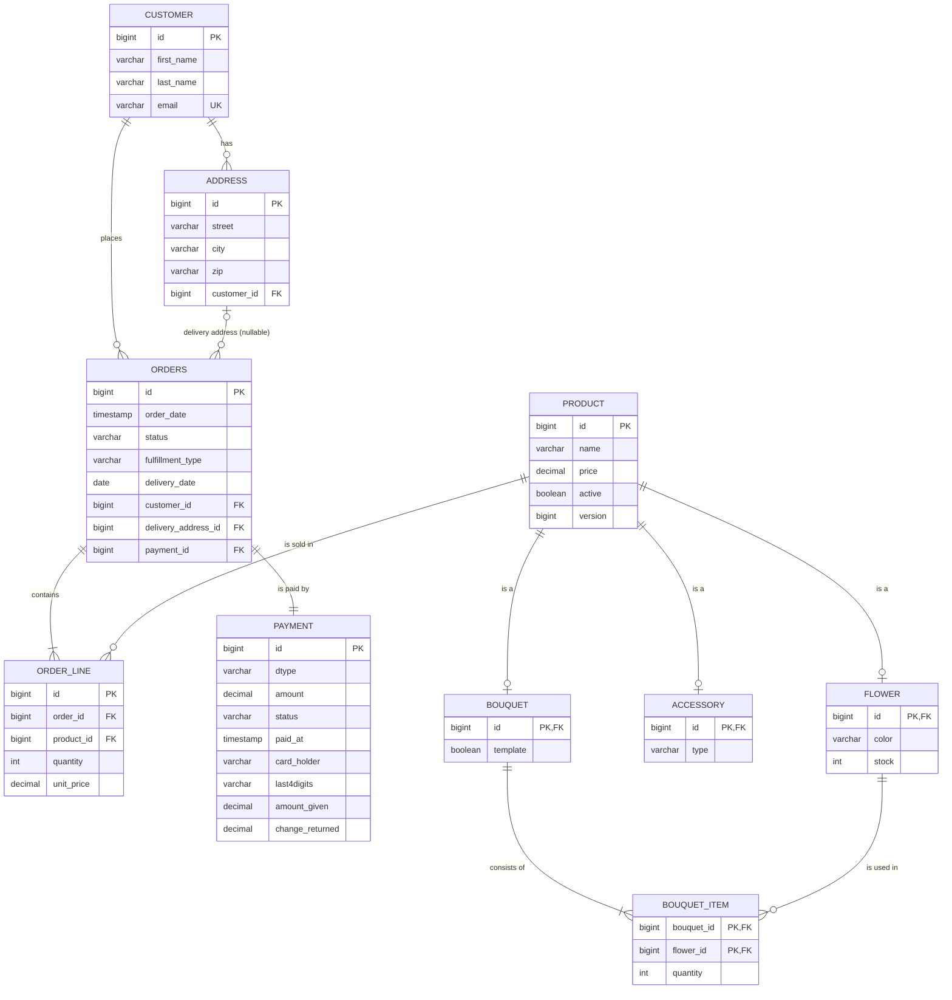
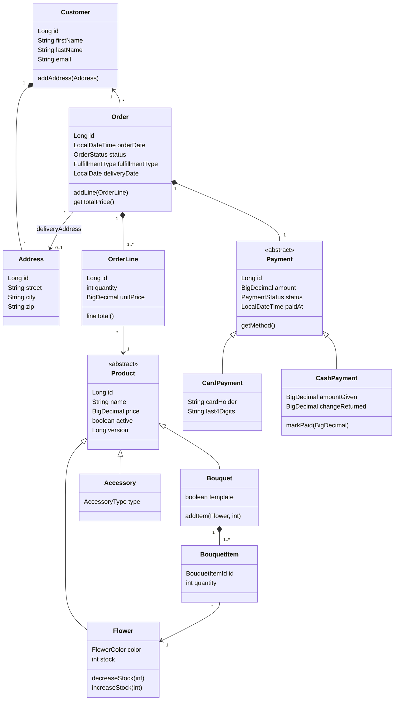

# Flower Shop 

## Data Model
The flower shop sells **flowers**, **accessories** and **bouquets**. The bouquet
builder is the main feature: customers compose their own bouquet from flowers and
then order it. Customers are guests (no accounts, no passwords). They are created
or reused by e-mail at checkout.
### Entity-relationship diagram (database tables)

### Class diagram (entities and inheritance)

### Entities
| Entity | Purpose | Key fields |
|---|---|---|
| **Customer** | Guest who orders. Reused by e-mail | `firstName`, `lastName`, `email` (unique) |
| **Address** | Delivery address of a customer | `street`, `city`, `zip` |
| **Product** | Abstract base of everything sellable | `name`, `price`, `active`, `version` |
| **Flower** | A single flower type | `color`, `stock` |
| **Accessory** | Vase, ribbon, card, wrapping | `type` |
| **Bouquet** | Composition of flowers (customer-made or shop template) | `template`, `items` |
| **BouquetItem** | One flower type in a bouquet | composite key (`bouquetId`, `flowerId`), `quantity` |
| **Order** | A purchase | `status`, `fulfillmentType`, `deliveryDate` |
| **OrderLine** | One product on an order | `quantity`, `unitPrice` (price snapshot) |
| **Payment** | Abstract payment of an order | `amount`, `status`, `paidAt` |
| **CardPayment** | Card payment (simulated) | `cardHolder`, `last4Digits` |
| **CashPayment** | Cash payment at pickup | `amountGiven`, `changeReturned` |
### Enums
| Enum | Values |
|---|---|
| `OrderStatus` | NEW, PAID, READY, COMPLETED, CANCELLED |
| `FulfillmentType` | DELIVERY, PICKUP |
| `PaymentMethod` | CARD, CASH |
| `PaymentStatus` | PENDING, PAID |
| `AccessoryType` | VASE, RIBBON, CARD, WRAPPING |
| `FlowerColor` | e.g. RED, WHITE, YELLOW, PINK, ORANGE, PURPLE, MIXED |
All enums are stored as text (`EnumType.STRING`).
### JPA concepts used
| Requirement | Where |
|---|---|
| Master/detail | `Order` → `OrderLine`, `Bouquet` → `BouquetItem`, `Customer` → `Address` (cascade + orphan removal) |
| Composite key | `BouquetItem` with `@EmbeddedId BouquetItemId` and `@MapsId` |
| Inheritance | `Product` (`JOINED`) and `Payment` (`SINGLE_TABLE`) |
| Optimistic locking | `@Version` on `Product` (two customers buy the last roses → HTTP 409) |
| Soft delete | `Product.active` |
| Price snapshot | `OrderLine.unitPrice` is copied from the product at purchase time |
### Calculated values (not stored)
| Value | Calculation |
|---|---|
| `Order.totalPrice` | sum of all `OrderLine.lineTotal` |
| `OrderLine.lineTotal` | `unitPrice × quantity` |
| `Bouquet.price` | sum of `flower.price × item.quantity`, set by the service |
| `Payment.amount` | order total at checkout |
| `Payment.method` | derived from the subclass (`CardPayment` / `CashPayment`) |
| `productType` in DTOs | derived from the subclass (FLOWER / ACCESSORY / BOUQUET) |
### Business rules
- **Guests:** no accounts. At checkout the customer is found by e-mail or created.
- **Delivery vs. pickup:** `DELIVERY` requires an address. For `PICKUP`, `deliveryAddress` is `null`. `deliveryDate` is the delivery or pickup date.
- **Payment:** card is `PAID` at checkout. Cash is only allowed for pickup and starts as `PENDING`. The shop books it at pickup (`PUT /api/orders/{id}/pay`), which sets the change.
- **Card data:** only `last4Digits` is stored, never the full card number.
- **Bouquets:** the price is calculated by the server and never sent by the client. Stock is checked when creating a bouquet and reduced at checkout.
- **Stock booking:** a flower line reduces `stock` by `quantity`. A bouquet line reduces each flower by `item.quantity × line.quantity`.
- **Cancel:** only while the order is `NEW` and the payment is `PENDING`. The stock is restored.
- **Quantities:** `BouquetItem.quantity` is the number of stems per bouquet, `OrderLine.quantity` is the number of bouquets bought.
- **Table name:** `Order` is mapped to `orders`, because `order` is a reserved SQL word.
### Complex queries
| Query | Technique |
|---|---|
| Bestsellers (sold more than N times) | `GROUP BY` + `HAVING` |
| Products that were never ordered | `LEFT JOIN` (outer join) |
| Customers with more than N orders and their total spend | `GROUP BY` + `HAVING` |
| Stock warning list | JPQL with threshold parameter |
| Dynamic flower search (color, max price, in stock) | Criteria API |
| Order history of a customer | `JOIN FETCH` (avoids N+1) |
