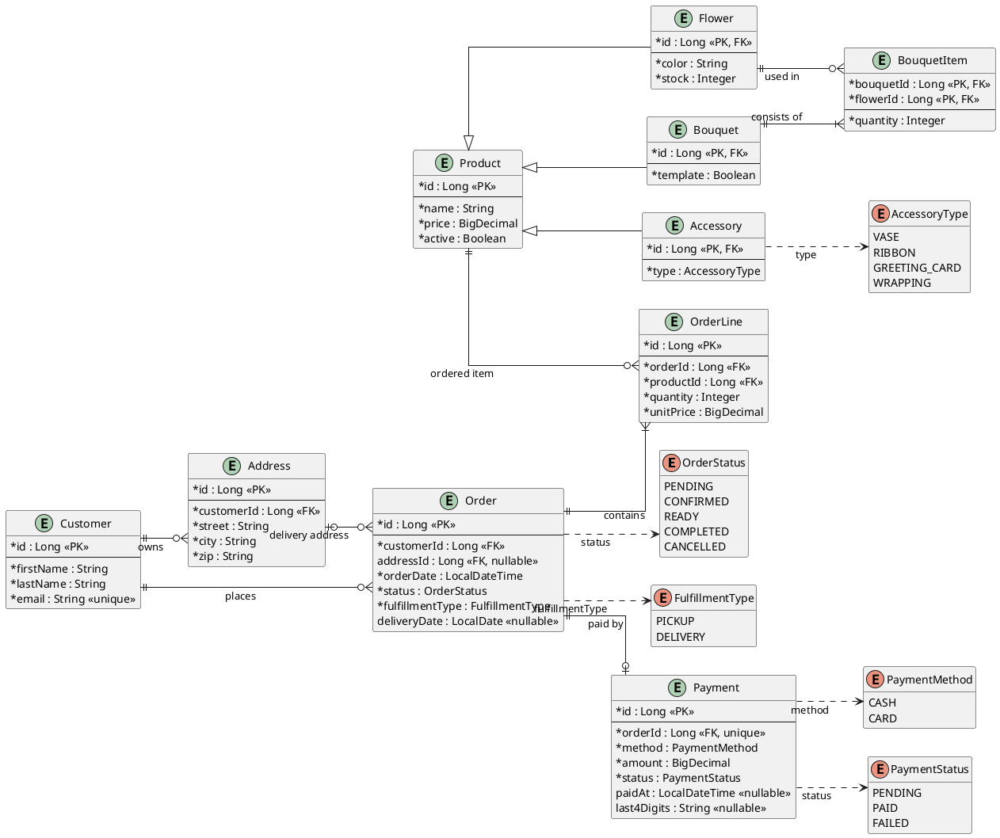

# Florale Bestellungen (DBI-Projekt)

Quarkus-REST-Backend für einen Blumenladen. Kund:innen stellen Bestellungen aus Blumen,
Accessoires und selbst zusammengestellten Bouquets zusammen. Der Preis wird zum
Bestellzeitpunkt gespeichert; Bezahlung und Bestellstatus werden im Ablauf aktualisiert.

> **Stand:** Dies ist ein fachlicher Entwurf auf Basis der vorhandenen Request-/DTO-Typen.
> Die Entities sind noch Platzhalter, Resources und Services existieren noch nicht.
> Endpoints und Service-Methoden sind Vorschläge. Kardinalitäten und JPA-Mappings müssen
> beim Implementieren mit dem ERD abgestimmt werden.

## Schnellstart

Voraussetzung: PostgreSQL ist erreichbar und in `src/main/resources/application.properties`
konfiguriert.

```shell
./mvnw quarkus:dev     # Windows: .\mvnw.cmd quarkus:dev
./mvnw test
```

## Datenmodell

Zehn Entities. `Product` ist die Oberklasse von `Flower`, `Accessory` und `Bouquet`.
`BouquetItem` verbindet ein Bouquet mit einer Blume und speichert die Menge
(zusammengesetzter Schlüssel aus `bouquetId` und `flowerId`).


**Fachliche Regeln**

- Ein Kunde hat mehrere Adressen und Bestellungen.
- Eine Bestellung hat mindestens eine Position, jede Position bezieht sich auf ein Produkt
  und speichert den Einzelpreis zum Bestellzeitpunkt.
- Eine Bestellung hat höchstens eine Zahlung. Gespeichert werden höchstens die letzten
  vier Kartenziffern, nie die vollständige Nummer.
- Die Lieferadresse ist bei Abholung optional.
- Bestellungen werden nicht gelöscht: Eine Stornierung ist die Statusänderung auf `CANCELLED`.
- Produkte mit Bestellhistorie werden deaktiviert statt gelöscht.

## REST API (geplant)

Präfix `/api`. Die API liefert ausschließlich DTOs, nie JPA-Entities. Erfolgreiche
`POST`-Aufrufe antworten mit `201 Created` und `Location`-Header. Mit **(neu)** markierte
Typen müssen noch entworfen werden.

### Kund:innen

| Endpoint | Request → Response | Service-Methode |
|---|---|---|
| `POST /customers` | `CreateCustomerRequest` → `CustomerDTO` | `createCustomer` (legt auch die erste Adresse an, prüft E-Mail-Duplikate) |
| `GET /customers/{id}` | → `CustomerDTO` | `getCustomer` |
| `PUT /customers/{id}` | `UpdateCustomerRequest` (neu) → `CustomerDTO` | `updateCustomer` |
| `GET /customers/{id}/orders` | Filter `from`, `to`, `status` → Bestellübersicht | `getCustomerOrders` |
| `DELETE /customers/{id}` | → `204`, sonst `409` | `deleteCustomer` (nur ohne Bestellhistorie) |

### Produkte und Bouquets

| Endpoint | Request → Response | Service-Methode |
|---|---|---|
| `GET /products` | Filter `type`, `active` → `ProductDTO[]` | `listProducts` |
| `GET /products/{id}` | → passendes Produkt-DTO | `getProduct` |
| `GET /flowers` | Filter `color`, `availableOnly` → `FlowerDTO[]` | `listAvailableFlowers` |
| `POST /flowers` | `CreateFlowerRequest` (neu) → `FlowerDTO` | `createFlower` |
| `POST /accessories` | `CreateAccessoryRequest` (neu) → `AccessoryDTO` | `createAccessory` |
| `GET /bouquets` | → `BouquetDTO[]` | – |
| `POST /bouquets` | `CreateBouquetRequest` → `BouquetDTO` | `createBouquet` (Blumen und Mengen validieren) |
| `PUT /products/{id}` | typgerechter Update-Request (neu) → Produkt-DTO | `updateProduct` |
| `PATCH /products/{id}/active` | `{ "active": false }` → `ProductDTO` | `setProductActive` |
| `DELETE /products/{id}` | → `204`, sonst `409` | `deleteProduct` (nur unreferenzierte Produkte) |

### Bestellungen und Zahlungen

| Endpoint | Request → Response | Service-Methode |
|---|---|---|
| `POST /orders` | `CreateOrderRequest` → `OrderDTO` | `createOrder` (prüft Kunde, Adresse, aktive Produkte und Mengen; übernimmt Preis-Snapshot) |
| `GET /orders/{id}` | → `OrderDTO` (inkl. Kunde, Adresse, Positionen, Zahlung) | `getOrder` |
| `GET /orders` | Filter `customerId`, `status`, `from`, `to` → `OrderDTO[]` | `searchOrders` |
| `PATCH /orders/{id}/status` | `UpdateOrderStatusRequest` → `OrderDTO` | `updateOrderStatus` (prüft Übergänge); Stornierung über `cancelOrder` |
| `POST /orders/{id}/payment` | `MarkPaidRequest` → `PaymentDTO` | `markOrderPaid` (bei Bargeld `amountGiven` prüfen) |

Zusätzlich vorgesehen: `getPaymentForOrder` (Zahlungsstatus und sichere Details) sowie
zwei Auswertungen, für die noch kein Endpoint festgelegt ist: `findBestSellingProducts(from, to, minimumQuantity)`
und `getCustomerOrderSummary(minimumOrders)`.

### Fehlerantworten

| Status | Wann |
|---|---|
| `400 Bad Request` | ungültige Request-Daten (Bean Validation) |
| `404 Not Found` | unbekannte ID |
| `409 Conflict` | fachlicher Konflikt: Produkt bereits verwendet, zu wenig Bestand, ungültiger Statusübergang |

Bean Validation prüft nur die Form des Requests. Existenz, Beziehungen, Bestand und
Geschäftsregeln prüfen die Services.

## Architektur

```text
Resource -> Service -> Repository -> EntityManager / JPQL -> PostgreSQL
               |
            Mapper -> DTO
```

| Schicht | Verantwortung |
|---|---|
| Resource | HTTP, Validierung am API-Rand, Statuscodes, DTOs |
| Service | Geschäftsregeln, Domain-Exceptions, Transaktionen |
| Repository | `EntityManager`, parametrisierte JPQL, Persistenz |
| Mapper | Entity ↔ DTO; nur bereits geladene Beziehungen verwenden |

Schreibende Service-Methoden sind `@Transactional`. Für Updates wird die Entity im selben
Persistence Context geladen und verändert, Hibernate erkennt die Änderung beim Commit.
Service-Namen und Signaturen sind ein Vorschlag und dürfen angepasst werden.

## Komplexe Abfragen

Beschrieben sind die benötigten Ergebnisse. Die JPQL wird im Repository geschrieben und getestet.

1. **Kund:innen mit Bestellanzahl und Umsatz:** `LEFT JOIN`, damit auch Kund:innen ohne
   Bestellung erscheinen. Gruppierung, optionales `HAVING` auf Mindestanzahl,
   Ergebnis als DTO-Projektion.
2. **Meistverkaufte Produkte im Zeitraum:** Positionen nach Produkt gruppieren, Mengen
   summieren, mit `HAVING` auf Mindestmenge filtern (für `findBestSellingProducts`).
3. **Bestelldetails für `GET /orders/{id}`:** Bestellung mit Kund:in, Adresse, Zahlung und
   Positionen samt Produktdaten laden, soweit der Mapper sie braucht. Nicht mehrere
   Collections gleichzeitig fetchen, weitere Daten per begrenzter Folgeabfrage laden.

## Tests

- **Unit-Tests:** JUnit 5 und Mockito für Services: Happy Paths, Fehlerfälle und Nachweis,
  dass bei Validierungsfehlern nichts geschrieben wird.
- **Integrationstests:** `@QuarkusTest` und RestAssured gegen REST und PostgreSQL:
  Statuscodes, Bodies, `Location`-Header und Fehlerpfade.